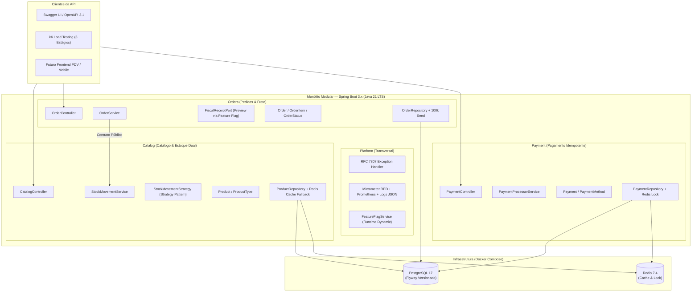

# Nível: Projeto A — Monólito Modular API-First

[](https://adoptium.net/)
[](https://spring.io/projects/spring-boot)
[](https://www.postgresql.org/)
[](https://redis.io/)
[](https://www.docker.com/)
[](.github/workflows/ci.yml)

Plataforma de alta performance para controle de vendas, distribuição de água mineral, gestão de pedidos (balcão e entrega) e controle de estoque dual de vasilhames retornáveis (cheios vs. vazios), construída segundo os padrões do **Projeto Final Full Cycle (Nível A — Avançado)**.

---

## 🏛️ Arquitetura do Sistema

O sistema foi arquitetado como um **Monólito Modular API-First** sob o pacote raiz `com.distribuidora.agua`, garantindo fronteiras estritas entre contextos de negócio sem a sobrecarga de rede e complexidade operacional de microsserviços distribuídos.



---

## 🚀 Execução em 1-Comando (Docker Compose)

A aplicação e todas as suas dependências sobem prontas para homologação com um único comando:

```bash
docker compose up -d --build
```

O compose inicializa os contêineres na ordem determinística através de *healthchecks*:
1. `agua_postgres` (PostgreSQL 17 Alpine) na porta `5432`
2. `agua_redis` (Redis 7.4 Alpine) na porta `6379`
3. `agua_api` (Spring Boot Java 21 via multi-stage Dockerfile) na porta `8080`

Para verificar o status da inicialização:
```bash
docker compose ps
docker compose logs -f app
```

Para encerrar a infraestrutura:
```bash
docker compose down -v
```

---

## 💻 Desenvolvimento Local e Suíte de Testes

### Pré-requisitos
- **Java 21 LTS** instalado
- **Docker e Docker Compose** (para infraestrutura local de apoio)

### Subir apenas os serviços de banco e cache (para rodar a app na IDE):
```bash
docker compose up -d postgres redis
```

### Executar a aplicação localmente:
- **Windows (PowerShell/CMD):**
  ```powershell
  .\mvnw.cmd spring-boot:run
  ```
- **Linux/macOS:**
  ```bash
  ./mvnw spring-boot:run
  ```

### Executar a suíte completa de testes automatizados e JaCoCo:
- **Windows:**
  ```powershell
  .\mvnw.cmd clean test
  ```
- **Linux/macOS:**
  ```bash
  ./mvnw clean test
  ```

---

## 📊 Endpoints REST e Observabilidade

Uma vez inicializada a aplicação em `http://localhost:8080`:

| Funcionalidade / Recurso | URL | Descrição |
| :--- | :--- | :--- |
| **Documentação Interativa** | [`/swagger-ui.html`](http://localhost:8080/swagger-ui.html) | OpenAPI 3.1 com Swagger UI interativo |
| **Contrato OpenAPI (JSON)** | [`/v3/api-docs`](http://localhost:8080/v3/api-docs) | Esquema bruto do contrato de API |
| **Healthcheck do Contêiner** | [`/actuator/health`](http://localhost:8080/actuator/health) | Diagnóstico de integridade dos componentes |
| **Métricas RED (Prometheus)** | [`/actuator/prometheus`](http://localhost:8080/actuator/prometheus) | Métricas de Rate, Errors e Duration para Prometheus |
| **Catálogo de Produtos** | `/api/v1/catalog/products` | Consulta de produtos com cache Redis resiliente |
| **Pedidos** | `/api/v1/orders` | Criação e consulta paginada de pedidos |
| **Pagamentos Idempotentes** | `/api/v1/payments` | Processamento idempotente com cabeçalho `Idempotency-Key` |
| **Feature Flags** | `/api/v1/platform/features` | Alternância em tempo de execução de flags de negócio |

---

## 📂 Estrutura de Diretórios do Projeto

```text
.
├── docker-compose.yml               # Orquestração 1-comando (Postgres 17, Redis 7.4, App)
├── Dockerfile                       # Multi-stage build seguro (Java 21 Temurin non-root)
├── .env.example                     # Declaração padronizada de variáveis de ambiente
├── README.md                        # Documentação oficial do projeto (Nível A)
├── CONTRIBUTORS.md                  # Evidência de autoria e responsabilidades
├── pom.xml                          # Descritor Maven, dependências e JaCoCo coverage gate
├── docs/
│   ├── especificacao-formal.md      # Especificação Formal de Requisitos (SRS v2.0.0)
│   ├── artefato.md                  # Diretrizes oficiais do curso (Prof. Henrique Lopes Lima)
│   ├── ia.md                        # Registro dos prompts decisivos de IA
│   ├── adr/                         # Architecture Decision Records (formato MADR)
│   │   ├── 0001-modular-monolith-api-first.md
│   │   └── 0002-dual-stock-strategy-pattern.md
│   └── c4/                          # Diagramas C4 Model em Mermaid
│       ├── contexto.md
│       └── container.md
├── src/
│   ├── main/
│   │   ├── java/com/distribuidora/agua/
│   │   │   ├── catalog/             # Módulo Catálogo & Estoque Dual
│   │   │   ├── orders/              # Módulo Pedidos & Cupom Fiscal
│   │   │   ├── payment/             # Módulo Pagamentos Idempotentes
│   │   │   └── platform/            # Módulo Transversal (Erros RFC 7807, Observabilidade, Flags)
│   │   └── resources/
│   │       ├── application.properties
│   │       └── db/migration/        # Migrações versionadas Flyway (V1, V2)
│   └── test/                        # Suíte de testes unitários, integração e borda
└── .github/
    └── workflows/
        └── ci.yml                   # Esteira de CI automatizada (Build, Test, JaCoCo, Gitleaks)
```

---

## 🛡️ Padrões de Qualidade e Governança
- **100% Inglês:** Todo o código-fonte, schemas Flyway e entidades são estritamente escritos em inglês técnico.
- **TDD Rigoroso:** Testes unitários de domínio e integração escritos antes da implementação (Red ➔ Green ➔ Refactor).
- **Sem Segredos Expostos:** Chaves e credenciais externalizadas via variáveis de ambiente com defaults seguros apenas para ambiente de testes local.
- **SOLID & Design Patterns:** Aplicação formal do Strategy Pattern (`StockMovementStrategy`) para eliminação de condicionais complexas no ciclo de vida de vasilhames retornáveis.
