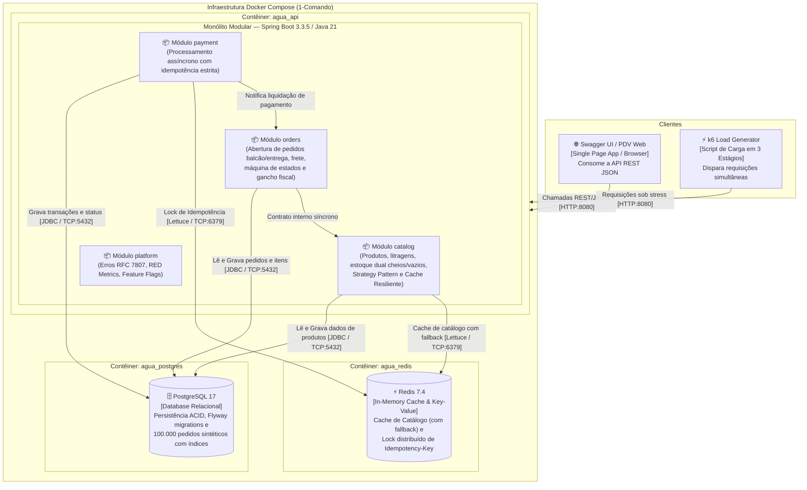

# Diagrama C4 — Nível 2: Contêineres de Sistema

**Projeto:** Gerenciador de Vendas de Água Mineral (Marketplace & PDV Modular)  
**Versão:** 2.0.0 (Projeto A — Full Cycle)  
**Rastreabilidade:** RNF-M4.1

---

## 1. Visão Geral de Contêineres

O diagrama de contêineres descreve a arquitetura de implantação de alto nível e as responsabilidades dos componentes de software em execução dentro da infraestrutura orquestrada por Docker Compose.

---

## 2. Elementos e Responsabilidades de Implantação

| Contêiner | Tecnologia | Porta | Responsabilidade |
| :--- | :--- | :---: | :--- |
| **`agua_api`** | Eclipse Temurin 21 JRE, Spring Boot 3.3.5 | `8080` | Executa o monólito modular, expõe endpoints REST, processa transações e métricas RED. |
| **`agua_postgres`** | PostgreSQL 17 Alpine | `5432` | Armazena o schema relacional versionado por Flyway (`products`, `orders`, `order_items`, `payments`) e a base volumosa de 100k pedidos. |
| **`agua_redis`** | Redis 7.4 Alpine | `6379` | Camada de cache volátil para listagem de catálogo com fallback gracioso para o banco e locks de idempotência. |
