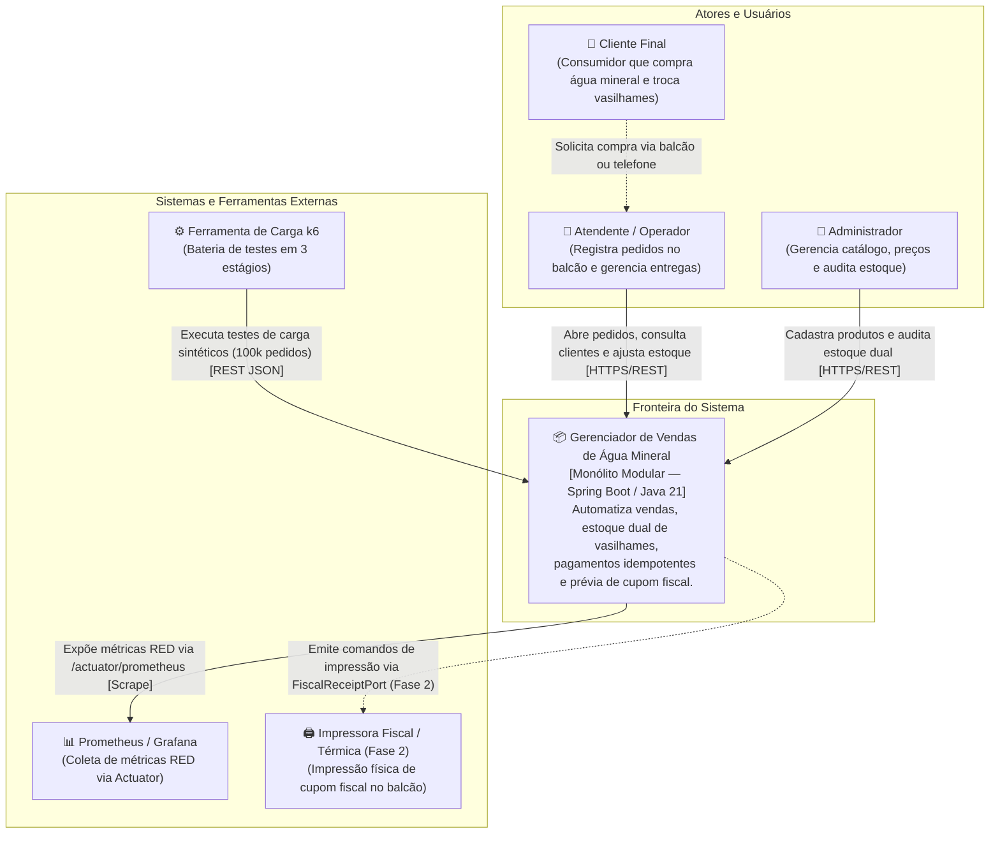

# Diagrama C4 — Nível 1: Contexto de Sistema

**Projeto:** Gerenciador de Vendas de Água Mineral (Marketplace & PDV Modular)  
**Versão:** 2.0.0 (Projeto A — Full Cycle)  
**Rastreabilidade:** RNF-M4.1

---

## 1. Visão Geral de Contexto

O diagrama de contexto descreve as fronteiras do sistema, seus usuários (atores) e os sistemas externos ou clientes com os quais interage.

---

## 2. Elementos do Diagrama

| Elemento | Tipo | Descrição |
| :--- | :--- | :--- |
| **Atendente / Operador** | Pessoa | Usuário operacional responsável pelo fluxo ágil de vendas, seleção de itens e baixa de vasilhames. |
| **Administrador** | Pessoa | Usuário gestor responsável pela gestão de catálogo, litragens, auditoria de estoque e preços. |
| **Gerenciador de Vendas de Água** | Sistema de Software | Monólito Modular API-First que encapsula as regras de negócio de catálogo, pedidos e pagamentos. |
| **k6 Load Testing** | Sistema Externo | Suite de testes de carga para avaliação de latência p95 sobre base de 100 mil pedidos sintéticos. |
| **Prometheus** | Sistema Externo | Plataforma de observabilidade que realiza *scraping* periódico das métricas em `/actuator/prometheus`. |
| **Impressora Fiscal (Fase 2)** | Dispositivo Externo | Hardware físico que receberá eventos de impressão através do gancho desacoplado `FiscalReceiptPort`. |
