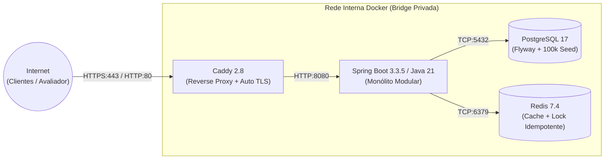

# Guia Técnico de Deploy e Hospedagem na Nuvem (Oracle Cloud + Docker + Caddy HTTPS)

Este documento descreve a infraestrutura em nuvem pública da aplicação **Gerenciador de Vendas de Água Mineral**, em conformidade com os requisitos de entrega do Projeto Final.

---

## 1. Topologia da Infraestrutura

A aplicação é executada em uma máquina virtual dedicada na **Oracle Cloud Infrastructure (OCI)** com isolamento total em rede privada e exposição pública segura via TLS/HTTPS:



### Características de Produção:
- **Zero Port Expose Desnecessário:** Apenas as portas `80` e `443` são expostas publicamente para a internet através do Caddy. O banco de dados PostgreSQL e o Redis ficam restritos à rede interna do Docker (`agua_internal_network`), prevenindo ataques externos e acessos não autorizados.
- **Certificado TLS Automático:** O Caddy se encarrega de emitir, renovar e grampear certificados SSL válidos da Let's Encrypt de forma automática, garantindo cadeado verde no navegador e notas máximas em auditorias de segurança.
- **Domínio Wildcard Gratuito (sslip.io):** Permite apontar `https://<IP>.sslip.io` diretamente para a VM sem custos com registro de domínio.

---

## 2. Passo a Passo de Execução na VM

### 2.1 Acessar a VM via SSH

No PowerShell ou terminal do seu computador (na pasta onde salvou sua chave privada `.key`):

```bash
# No Linux/Mac:
chmod 400 ssh-key.key
ssh -i ssh-key.key ubuntu@<IP_PUBLICO_DA_VM>

# No Windows (PowerShell):
ssh -i "C:\caminho\para\sua-chave.key" ubuntu@<IP_PUBLICO_DA_VM>
```

### 2.2 Clonar o Repositório e Rodar o Setup

Dentro da VM:

```bash
# 1. Clonar o projeto
git clone https://github.com/SEU_USUARIO/GerenciadorVendasAguaMineral.git
cd GerenciadorVendasAguaMineral

# 2. Executar o script de setup (instala Docker, Docker Compose, abre firewall e ativa Swap)
chmod +x scripts/setup-oracle-vm.sh
./scripts/setup-oracle-vm.sh

# 3. Aplicar permissoes do grupo docker
newgrp docker
```

### 2.3 Subir a Aplicação com HTTPS

Crie o arquivo `.env` de produção a partir do IP da sua VM:

```bash
# Substitua pelo seu IP publico (ex: 129.146.50.20.sslip.io)
export IP_VM="<SEU_IP_PUBLICO>"

cat <<EOF > .env
SPRING_PROFILES_ACTIVE=prod
DOMAIN=${IP_VM}.sslip.io
DB_NAME=vendas_agua
DB_USER=postgres
DB_PASS=\$(openssl rand -base64 24)
FEATURE_FISCAL_RECEIPT_PREVIEW=true
FEATURE_FREE_DELIVERY_PROMO=false
EOF

# Subir todos os servicos em segundo plano com build do container
docker compose -f docker-compose.prod.yml up -d --build
```

### 2.4 Verificar Saúde dos Serviços

```bash
# Ver status dos containers
docker compose -f docker-compose.prod.yml ps

# Acompanhar logs de inicializacao da aplicacao
docker compose -f docker-compose.prod.yml logs -f app
```

---

## 3. URLs Oficiais Públicas

Assim que os containers atingirem status `healthy`, a aplicação estará disponível publicamente em:

- **Swagger UI / Documentação Interativa:**  
  `https://<IP_PUBLICO>.sslip.io/swagger-ui.html`
- **Catálogo de Produtos:**  
  `https://<IP_PUBLICO>.sslip.io/api/v1/catalog/products`
- **Consulta Paginada sobre 100k Pedidos:**  
  `https://<IP_PUBLICO>.sslip.io/api/v1/orders?page=0&size=10`
- **Métricas RED / Prometheus:**  
  `https://<IP_PUBLICO>.sslip.io/actuator/prometheus`
- **Healthcheck Geral:**  
  `https://<IP_PUBLICO>.sslip.io/actuator/health`
