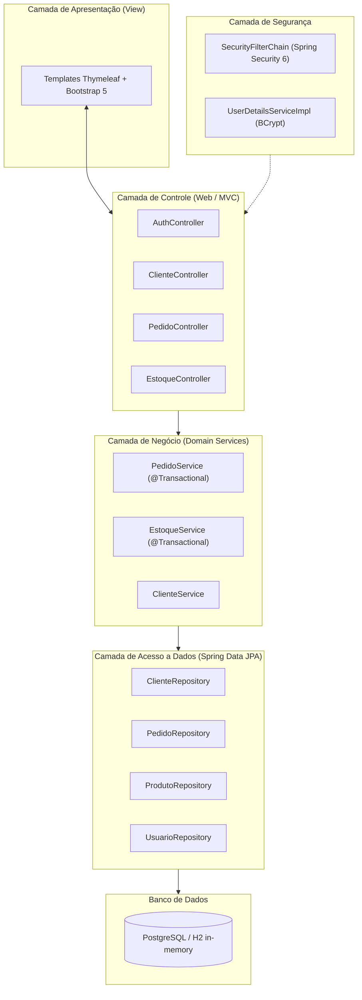

# Especificação Formal de Requisitos e Arquitetura de Software (SRS)

**Projeto:** Gerenciador de Vendas de Água Mineral  
**Versão:** 1.0.0  
**Status:** Aprovado para Implementação  
**Data:** 29 de Outubro de 2026  

---

## 1. Visão Geral e Propósito

### 1.1 Objetivo do Sistema
O **Gerenciador de Vendas de Água Mineral** é uma aplicação monolítica modular construída sobre **Spring Boot 3.x** e **Thymeleaf**, concebida para automatizar e otimizar os processos operacionais de distribuidoras e depósitos de água mineral. O sistema abrange a venda no balcão e pedidos para entrega, gestão de clientes, histórico de transações, controle de acessos (RBAC) e, prioritariamente, o ciclo de vida e controle de estoque de vasilhames retornáveis de 20 litros (cheios vs. vazios).

### 1.2 Stakeholders e Atores
- **Administrador (`ROLE_ADMIN`):** Responsável por configurações gerais, cadastro de produtos/preços, gestão de contas de operadores, auditoria de estoque e relatórios financeiros.
- **Atendente / Operador (`ROLE_ATENDENTE`):** Responsável pelo atendimento diário: abertura de pedidos, consulta e cadastro ágil de clientes, despacho de entregas e finalização de vendas.
- **Cliente:** Pessoa física ou jurídica que adquire água mineral e/ou vasilhames, solicitando entrega em domicílio ou retirando no balcão da distribuidora.

---

## 2. Requisitos Funcionais (RF)

| ID | Nome | Descrição | Regras e Validações | Critérios de Aceitação |
|---|---|---|---|---|
| **RF-001** | Autenticação de Usuários | Permitir que operadores e administradores façam login no sistema com usuário e senha criptografada. | Senhas devem ser armazenadas com hash BCrypt. Sessões com timeout padrão de 30 minutos. | Acesso bloqueado para credenciais inválidas; redirecionamento para o dashboard correspondente após login. |
| **RF-002** | Controle de Acesso Baseado em Perfis (RBAC) | Restringir rotas e ações no sistema conforme o perfil do usuário logado (`ADMIN` vs `ATENDENTE`). | Menus e endpoints administrativos inacessíveis para o perfil `ATENDENTE`. | Tentativa de acesso a rotas restritas resulta em HTTP 403 / página de acesso negado amigável. |
| **RF-003** | Cadastro e Gestão de Clientes | Permitir a inclusão, alteração, consulta e listagem de clientes. | Campos obrigatórios: Nome e Telefone. Telefone deve permitir busca rápida (indexado). | Não permitir cadastros com telefone vazio. Busca parcial por nome ou telefone deve retornar resultados em tempo hábil. |
| **RF-004** | Gestão de Endereços para Entrega | Registrar endereço detalhado vinculado ao cliente para expedição de entregas. | Logradouro, Número, Bairro e Ponto de Referência (opcional: complemento). | Endereço exibido de forma proeminente na ordem de entrega do pedido. |
| **RF-005** | Catálogo de Produtos, Volumes e Preços | Gerenciar catálogo de produtos com diferentes litragens (ex: 20L, 10L, 5L, 1.5L, 500ml) e classificação de retornabilidade. | Campos: Nome, Capacidade em Litros (`capacidade_litros`), indicador `retornavel` (booleano) e Tipo: `AGUA_COMPLETA` (água + vasilhame), `REFIL` (líquido com troca), `VASILHAME_VAZIO`, `DESCARTAVEL`. | Preço de venda e capacidade em litros devem ser maiores que zero. |
| **RF-006** | Controle de Estoque por Produto e Vasilhame | Manter o saldo em tempo real de unidades cheias e vasilhames vazios segregados por produto e litragem. | 1. Venda `AGUA_COMPLETA`: decrementa cheios do produto. 2. Venda `REFIL` (somente produtos retornáveis): decrementa cheios e incrementa vazios do respectivo produto/litragem. 3. Venda `VASILHAME_VAZIO`: decrementa vazios do produto. 4. Venda `DESCARTAVEL`: decrementa estoque de cheios sem gerar vasilhame vazio. | Bloqueio de venda de itens com estoque insuficiente de cheios sem confirmação explícita do operador. |
| **RF-007** | Abertura e Registro de Pedidos (PDV) | Registrar pedidos selecionando cliente (ou venda anônima no balcão), itens, quantidades e forma de atendimento. | Modalidades: `BALCAO` (retirada imediata) ou `ENTREGA` (despacho externo). | Cálculo automático de subtotal, taxa de entrega e valor total. |
| **RF-008** | Taxa de Entrega Configurável | Permitir a aplicação de taxa de entrega no pedido. | Pode ser preenchida com valor padrão global configurado ou zerada para entregas isentas. | A taxa de entrega compõe o valor final a ser pago pelo cliente. |
| **RF-009** | Máquina de Estados do Pedido | Controlar o ciclo de vida do pedido através de transições de status válidas. | Estados: `PENDENTE` ➔ `EM_ENTREGA` ➔ `CONCLUIDO`. Estado `CANCELADO` disponível a partir de `PENDENTE` ou `EM_ENTREGA`. | Cancelamento de pedido deve estornar imediatamente as movimentações de estoque registradas. |
| **RF-010** | Formas de Pagamento | Registrar a forma de pagamento acordada com o cliente. | Opções válidas: `DINHEIRO`, `PIX`, `CARTAO_DEBITO`, `CARTAO_CREDITO`. | O pedido concluído deve registrar o meio de pagamento utilizado. |
| **RF-011** | Histórico de Compras por Cliente | Disponibilizar visão consolidada das últimas compras realizadas por um determinado cliente. | Exibir data, modalidade, itens adquiridos, total pago e status do pedido. | Na tela de detalhes do cliente ou no momento de abrir pedido, o operador visualiza o histórico recente. |

---

## 3. Requisitos Não Funcionais (RNF)

| ID | Categoria | Especificação Técnica |
|---|---|---|
| **RNF-001** | **Stack & Compatibilidade** | Desenvolvido estritamente em **Java 21 (LTS)** e **Spring Boot 3.3.x**, empacotado via **Apache Maven** (`mvnw`). |
| **RNF-002** | **Desempenho & Latência** | Tempo de resposta para carregamento de páginas Thymeleaf em rede local inferior a 200ms para consultas de até 10.000 clientes/pedidos. |
| **RNF-003** | **Persistência & Isolamento** | Uso de **Spring Data JPA** com dialeto PostgreSQL para ambiente de produção/desenvolvimento e H2 em memória para suíte de testes automatizados. |
| **RNF-004** | **Integridade Transacional** | Todas as operações de fechamento ou cancelamento de pedido devem ser atômicas (`@Transactional`), assegurando que a atualização de estoque e a persistência do pedido ocorram juntas. |
| **RNF-005** | **Interface & Usabilidade** | Renderização responsiva baseada em **Bootstrap 5**, otimizada para desktops de caixa e telas de tablets/smartphones utilizados por atendentes. |
| **RNF-006** | **Segurança da Informação** | Criptografia de senhas com algoritmo BCrypt (fator de custo 10+). Proteção nativa contra CSRF, XSS e Session Fixation provida pelo Spring Security. |
| **RNF-007** | **Cobertura de Testes** | Cobertura mínima de 80% das classes de serviço de domínio (`VendaService`, `EstoqueService`, `PedidoService`) via testes unitários com JUnit 5 e Mockito. |

---

## 4. Arquitetura de Software e Padrões de Projeto

A aplicação segue uma arquitetura em camadas tradicional e desacoplada:

### 4.1 Padrões Estruturais
- **DTOs (Data Transfer Objects):** Para transporte seguro de dados dos formulários HTML para os Services, com validações baseadas em Bean Validation (`@NotBlank`, `@NotNull`, `@Positive`).
- **Services Especializados:** Métodos curtos, com responsabilidade única (SRP), sem vazamento de lógica de negócio para os Controllers.
- **Global Exception Handling:** Manipulador central com `@ControllerAdvice` para tratar exceções de negócio (`EstoqueInsuficienteException`, `RecursoNaoEncontradoException`) e apresentar feedback claro ao usuário.

---

## 5. Dicionário de Dados e Modelo Relacional

### 5.1 Tabela `usuarios`
Armazena as credenciais e níveis de privilégio dos operadores do sistema.
- `id` (BIGSERIAL, PK): Identificador único do usuário.
- `login` (VARCHAR(50), NOT NULL, UNIQUE): Nome de usuário para autenticação.
- `nome_completo` (VARCHAR(100), NOT NULL): Nome para exibição na interface.
- `senha_hash` (VARCHAR(255), NOT NULL): Hash BCrypt da senha.
- `perfil` (VARCHAR(20), NOT NULL): Papel do usuário (`ROLE_ADMIN` ou `ROLE_ATENDENTE`).
- `ativo` (BOOLEAN, NOT NULL, DEFAULT TRUE): Indicador de usuário ativo/inativo.

### 5.2 Tabela `clientes`
Armazena a base de consumidores e seus endereços para agilizar contatos e entregas.
- `id` (BIGSERIAL, PK): Identificador único do cliente.
- `nome` (VARCHAR(100), NOT NULL): Nome do cliente ou razão social.
- `telefone` (VARCHAR(20), NOT NULL, INDEX): Telefone ou WhatsApp para contato e busca.
- `cpf_cnpj` (VARCHAR(20), NULL): Documento fiscal opcional.
- `logradouro` (VARCHAR(150), NOT NULL): Rua, avenida, travessa.
- `numero` (VARCHAR(20), NOT NULL): Número predial.
- `bairro` (VARCHAR(80), NOT NULL): Bairro de entrega.
- `complemento` (VARCHAR(100), NULL): Apto, bloco, etc.
- `ponto_referencia` (VARCHAR(200), NULL): Referência para o entregador.
- `data_cadastro` (TIMESTAMP, NOT NULL): Data e hora do registro.

### 5.3 Tabela `produtos`
Catálogo de itens comercializados com segregação de litragem, tipo e controle de estoque de cheios e vasilhames vazios (para retornáveis).
- `id` (BIGSERIAL, PK): Identificador único do produto.
- `nome` (VARCHAR(100), NOT NULL): Ex: "Água Mineral 20L Galão Completo", "Refil Água Mineral 20L", "Refil Galão 10L", "Água Mineral 500ml Sem Gás".
- `capacidade_litros` (NUMERIC(5,2), NOT NULL): Capacidade em litros (ex: 20.00, 10.00, 5.00, 1.50, 0.50, 0.20).
- `retornavel` (BOOLEAN, NOT NULL, DEFAULT TRUE): Indica se o item exige/controla o retorno de vasilhame vazio (ex: 20L e 10L retornáveis = true; 500ml descartável = false).
- `tipo_produto` (VARCHAR(30), NOT NULL): `AGUA_COMPLETA`, `REFIL`, `VASILHAME_VAZIO`, `DESCARTAVEL`.
- `preco_venda` (NUMERIC(10,2), NOT NULL): Valor unitário cobrado.
- `estoque_cheios` (INTEGER, NOT NULL, DEFAULT 0): Quantidade disponível com água para venda.
- `estoque_vazios` (INTEGER, NOT NULL, DEFAULT 0): Quantidade de vasilhames vazios no depósito (aplicável quando `retornavel = true`).
- `ativo` (BOOLEAN, NOT NULL, DEFAULT TRUE): Se o produto está ativo para venda.

### 5.4 Tabela `pedidos`
Cabeçalho de cada transação de venda realizada no balcão ou despachada para entrega.
- `id` (BIGSERIAL, PK): Número do pedido.
- `cliente_id` (BIGINT, NULL, FK -> `clientes.id`): Cliente associado (nulo para venda rápida de balcão).
- `usuario_id` (BIGINT, NOT NULL, FK -> `usuarios.id`): Operador responsável pelo pedido.
- `data_hora` (TIMESTAMP, NOT NULL): Momento de abertura do pedido.
- `modalidade` (VARCHAR(20), NOT NULL): `BALCAO` ou `ENTREGA`.
- `status` (VARCHAR(20), NOT NULL): `PENDENTE`, `EM_ENTREGA`, `CONCLUIDO`, `CANCELADO`.
- `forma_pagamento` (VARCHAR(20), NOT NULL): `DINHEIRO`, `PIX`, `CARTAO_DEBITO`, `CARTAO_CREDITO`.
- `taxa_entrega` (NUMERIC(10,2), NOT NULL, DEFAULT 0.00): Taxa de frete aplicada.
- `subtotal` (NUMERIC(10,2), NOT NULL): Soma do valor dos itens.
- `valor_total` (NUMERIC(10,2), NOT NULL): `subtotal + taxa_entrega`.
- `observacoes` (TEXT, NULL): Instruções especiais para a entrega.

### 5.5 Tabela `itens_pedido`
Detalhamento de produtos contidos no pedido.
- `id` (BIGSERIAL, PK): Identificador do item.
- `pedido_id` (BIGINT, NOT NULL, FK -> `pedidos.id`): Pedido pai.
- `produto_id` (BIGINT, NOT NULL, FK -> `produtos.id`): Produto vendido.
- `quantidade` (INTEGER, NOT NULL): Número de unidades.
- `preco_unitario` (NUMERIC(10,2), NOT NULL): Preço praticado no momento da venda.
- `valor_total_item` (NUMERIC(10,2), NOT NULL): `quantidade * preco_unitario`.
- `recolheu_vasilhame` (BOOLEAN, NOT NULL, DEFAULT FALSE): Indica se o item gerou entrada de vasilhame vazio no depósito.

---

## 6. Mapeamento de Rotas Web e Segurança

| Rota HTTP | Método | Permissão Mínima | Descrição / Template |
|---|---|---|---|
| `/login` | GET | `ANONYMOUS` | Exibição do formulário de autenticação (`login.html`). |
| `/login` | POST | `ANONYMOUS` | Processamento de credenciais via Spring Security. |
| `/logout` | POST | `AUTHENTICATED` | Invalidação de sessão do usuário. |
| `/` ou `/dashboard` | GET | `ROLE_ATENDENTE` | Dashboard operacional: pedidos do dia, atalhos de PDV e status de entregas. |
| `/clientes` | GET | `ROLE_ATENDENTE` | Listagem e pesquisa de clientes com paginação (`clientes/lista.html`). |
| `/clientes/novo` | GET / POST | `ROLE_ATENDENTE` | Formulário e gravação de novo cliente (`clientes/form.html`). |
| `/clientes/{id}/editar`| GET / POST | `ROLE_ATENDENTE` | Edição de dados cadastrais do cliente. |
| `/pedidos` | GET | `ROLE_ATENDENTE` | Painel de monitoramento de pedidos e entregas (`pedidos/painel.html`). |
| `/pedidos/novo` | GET / POST | `ROLE_ATENDENTE` | Abertura ágil de pedido no PDV (`pedidos/pdv.html`). |
| `/pedidos/{id}/status` | POST | `ROLE_ATENDENTE` | Transição de status do pedido (Pendente ➔ Em Entrega ➔ Concluído). |
| `/pedidos/{id}/cancelar`| POST | `ROLE_ATENDENTE` | Cancelamento de pedido com estorno automático no estoque. |
| `/estoque` | GET | `ROLE_ATENDENTE` | Visualização dos saldos de garrafões cheios e vazios (`estoque/visao.html`). |
| `/estoque/ajuste` | GET / POST | `ROLE_ADMIN` | Ajuste de inventário ou entrada de novas cargas da fonte (`estoque/ajuste.html`). |
| `/produtos/**` | ALL | `ROLE_ADMIN` | Cadastro, precificação e gestão de catálogo de produtos. |
| `/usuarios/**` | ALL | `ROLE_ADMIN` | Gestão de operadores e senhas de acesso. |

---

## 7. Critérios de Aceitação e Definição de Pronto (Definition of Done - DoD)

Uma tarefa ou módulo é considerado concluído somente quando:
1. Todas as regras de negócio associadas aos RFs correspondentes estão plenamente implementadas.
2. Não há erros de compilação ou regressão nos testes unitários e de integração (`.\mvnw.cmd test` executa com sucesso).
3. Todas as operações com banco de dados que alteram múltiplos registros utilizam `@Transactional`.
4. O código segue os padrões do `.agents/rules/clean-code.md` e `.agents/rules/engineering-standards.md`.
5. O commit é realizado conforme as diretrizes do `.agents/rules/git-workflow.md`.
