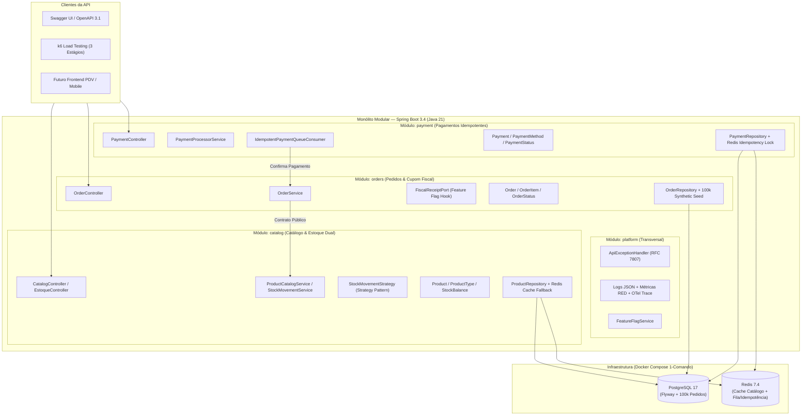

# Especificação Formal de Requisitos e Arquitetura de Software (SRS)

**Projeto:** Gerenciador de Vendas de Água Mineral (Marketplace & PDV Modular)  
**Versão:** 2.0.0 (Alinhada ao Projeto Final Full Cycle — Nível A + Evolução para Produção)  
**Status:** Aprovado para Implementação  
**Data de Atualização:** 05 de Novembro de 2026  

---

## 1. Visão Geral, Propósito e Estratégia em Duas Fases

### 1.1 Objetivo do Sistema
O **Gerenciador de Vendas de Água Mineral** é uma plataforma construída como um **Monólito Modular API-First** sobre **Java 21 (LTS)** e **Spring Boot 3.4**, inspirada no modelo de engenharia do projeto `GerenciadorPilates`. O sistema automatiza os processos de vendas e distribuição de água mineral (balcão e entrega), gerenciamento de catálogo multimarca/multilitragem, controle de estoque dual de vasilhames retornáveis (cheios vs. vazios), processamento idempotente de pagamentos e prévia de emissão de cupom fiscal.

### 1.2 Estratégia de Execução (Fase 1 vs. Fase 2)
Para cumprir com excelência o prazo de **13/11** do **Projeto Final Full Cycle (Nível A — Avançado)** sem inflar o escopo com integrações de hardware ou telas estáticas, o projeto é dividido em duas fases:

1. **Fase 1 — Core Engenharia & Projeto Final Nível A (Entrega até 13/11):**
   - Foco 100% nos **3 módulos de domínio exigidos no Projeto A** (`catalog`, `orders`, `payment`) + módulo transversal `platform`.
   - Exposição via **API REST JSON pura** documentada em **OpenAPI 3.1** (`docs/openapi.yaml` + Swagger UI), permitindo testes de contrato, integração com Testcontainers e bateria de carga em 3 estágios com **k6** sobre **100.000 pedidos sintéticos**.
   - Inclusão do **gancho arquitetural para Impressora Fiscal** (`FiscalReceiptPort`) controlado por **Feature Flag** (`feature.fiscal-receipt-preview`), gerando o payload/cupom estruturado sem depender de hardware físico no container Docker.
2. **Fase 2 — Expansão para Produção Real na Distribuidora (Pós-13/11):**
   - Adição do adaptador físico de **Impressora Térmica/Fiscal (ESC/POS / NFC-e / SAT)** implementando a interface `FiscalReceiptPort` já criada na Fase 1.
   - Adição dos módulos `customers` (cadastro completo de clientes e endereços) e `identityaccess` (autenticação JWT/RBAC para `ROLE_ADMIN` e `ROLE_ATENDENTE`).
   - Construção da interface visual de PDV rápido (Frontend Web).

---

## 2. Arquitetura de Monólito Modular (Modelo `GerenciadorPilates`)

O código-fonte é organizado sob o pacote raiz `com.distribuidora.agua` com fronteiras explícitas de módulo (validadas por `package-info.java` e testes arquiteturais), evitando pastas soltas ou acoplamento direto entre repositórios de módulos distintos.



### 2.1 Estrutura Interna de Cada Módulo
Seguindo o padrão do `GerenciadorPilates`, cada módulo de negócio (`catalog`, `orders`, `payment`) é subdividido em 4 camadas internas:
- `api`: Controllers REST, Request/Response Records (DTOs) com Bean Validation (`@NotBlank`, `@NotNull`, `@Positive`).
- `application`: Casos de uso transacionais (`@Transactional`), orquestração de regras, publicação/consumo de eventos e portas de saída.
- `domain`: Entidades de domínio, Enums, Strategies de negócio e exceções específicas do módulo.
- `infrastructure`: Repositórios Spring Data JPA, adaptadores Redis (cache com tolerância a falhas e fila idempotente) e adaptador de prévia de cupom fiscal.

---

## 3. Requisitos Funcionais — Fase 1 (Escopo Projeto Final Nível A)

| ID | Módulo | Nome | Descrição e Regras de Negócio | Critérios de Aceitação |
| :--- | :--- | :--- | :--- | :--- |
| **RF-001** | `catalog` | Catálogo de Produtos, Litragens e Preços | Gerenciar produtos com diferentes litragens (20L, 10L, 5L, 1.5L, 500ml), flag `retornavel` e classificação `TipoProduto`: `AGUA_COMPLETA`, `REFIL`, `VASILHAME_VAZIO`, `DESCARTAVEL`. | Preço de venda e capacidade em litros devem ser maiores que zero. Listagem do catálogo utiliza **Cache Redis** com TTL e fallback transparente para o PostgreSQL caso o Redis esteja indisponível. |
| **RF-002** | `catalog` | Motor de Estoque Dual via **Strategy Pattern** | Controlar saldos de unidades cheias (`estoque_cheios`) e vasilhames vazios (`estoque_vazios`) aplicando o **Strategy Pattern** por `TipoProduto`:<br>1. `AGUA_COMPLETA`: decrementa `estoque_cheios`.<br>2. `REFIL`: decrementa `estoque_cheios` e incrementa `estoque_vazios`.<br>3. `VASILHAME_VAZIO`: decrementa `estoque_vazios`.<br>4. `DESCARTAVEL`: decrementa `estoque_cheios` sem alterar `estoque_vazios`. | Tentativa de baixa acima do saldo disponível lança `InsufficientStockException` (HTTP 422). Qualquer alteração invalida o cache do catálogo no Redis. |
| **RF-003** | `orders` | Abertura de Pedidos (Balcão e Entrega) | Criar pedidos informando identificação do cliente (opcional no balcão), modalidade (`BALCAO` ou `ENTREGA`), itens e forma de pagamento pretendida. | Calcula automaticamente `subtotal`, aplica `taxa_entrega` (respeitando a Feature Flag de promoção de frete) e reserva/baixa o estoque de forma atômica (`@Transactional`). |
| **RF-004** | `orders` | Máquina de Estados do Pedido e Cancelamento com Estorno | Controlar transições válidas de status: `PENDENTE` ➔ `CONFIRMADO` ➔ `EM_ENTREGA` ➔ `CONCLUIDO`, ou `CANCELADO` (a partir de `PENDENTE`, `CONFIRMADO` ou `EM_ENTREGA`). | Transições inválidas (ex: cancelar pedido já `CONCLUIDO`) retornam HTTP 409/422. O cancelamento estorna imediatamente os saldos de galões cheios e vazios no módulo `catalog`. |
| **RF-005** | `orders` | Consulta Paginada e Filtrada em Base de Alto Volume (100k+) | Consultar pedidos por status, modalidade, cliente e intervalo de datas sobre uma base com pelo menos **100.000 pedidos sintéticos**. | Deve responder dentro do SLO (`p95 < 200ms`) após otimização com índice composto no PostgreSQL. |
| **RF-006** | `orders` / `platform` | Gancho de Impressão de Cupom Fiscal via **Feature Flag** | Disponibilizar porta `FiscalReceiptPort` acionada na confirmação/conclusão do pedido quando a Feature Flag `feature.fiscal-receipt-preview` estiver ativa, além da flag comercial `feature.free-delivery-promo` (frete grátis acima de valor mínimo). | Quando ativa, inclui o bloco estruturado do recibo/cupom fiscal na resposta do pedido e registra o evento de impressão para futuro acoplamento da impressora física na Fase 2. |
| **RF-007** | `payment` | Processamento de Pagamento com Fila e **Idempotência** | Processar pagamentos (`PIX`, `DINHEIRO`, `CARTAO_DEBITO`, `CARTAO_CREDITO`) exigindo cabeçalho/chave `Idempotency-Key` e processamento assíncrono/fila com garantia de idempotência no Redis + banco. | Requisições ou mensagens duplicadas com a mesma `Idempotency-Key` retornam o mesmo resultado já processado sem duplicar cobrança nem alterar o pedido duas vezes. |

---

## 4. Requisitos Não Funcionais e Mapeamento da Rubrica (Projeto A — 100 Pontos)

### 4.1 Módulo 1 — Base, Código, Design e Volume (35 Pontos)
- **RNF-M1.1 (Orquestração 1-Comando):** O arquivo `docker-compose.yml` na raiz deve subir `postgres`, `redis` e `app` com `docker compose up -d --build`, com *healthchecks* garantindo a ordem de inicialização.
- **RNF-M1.2 (SOLID & Design Pattern Justificado):** Aplicação de SRP e DIP entre módulos, mais o **Strategy Pattern** (`StockMovementStrategy`) para cálculo de estoque dual por tipo de produto, eliminando condicionais `if/switch` acopladas.
- **RNF-M1.3 (Database Pattern Registrado):** Uso do padrão **Data Mapper / Repository** via Spring Data JPA + Hibernate e migrações versionadas com **Flyway**, registrado em ADR frente à alternativa descartada (*Active Record / JDBC puro*).
- **RNF-M1.4 (Volume Sintético):** Migration/seed SQL utilizando `generate_series` do PostgreSQL para popular automaticamente **100.000 pedidos sintéticos** realistas distribuídos no tempo.

### 4.2 Módulo 2 — Testes Automatizados e Cobertura no CI (20 Pontos)
- **RNF-M2.1 (Testes Unitários):** JUnit 5 + Mockito cobrindo 100% das Strategies de estoque, máquina de estados do pedido, cálculo de frete/feature flags e regras de idempotência.
- **RNF-M2.2 (Testes de Integração):** Testes reais com Spring Boot Test / Testcontainers validando persistência transacional, baixa/estorno de estoque e idempotência.
- **RNF-M2.3 (Testes de Contrato de API):** Validação automatizada garantindo que os payloads JSON de `/api/v1/catalog/**`, `/api/v1/orders/**` e `/api/v1/payments/**` respeitam rigorosamente o schema `docs/openapi.yaml`.
- **RNF-M2.4 (Coverage Gate no Pipeline):** Plugin **JaCoCo** configurado no `pom.xml` com meta mínima obrigatória (`>= 80%` nas camadas de domínio/aplicação), falhando o build caso a cobertura caia abaixo do limite.

### 4.3 Módulo 3 — Entrega Contínua, Segurança e Observabilidade (15 Pontos)
- **RNF-M3.1 (Pipeline CI Completo):** Workflow `.github/workflows/ci.yml` executando:
  1. Lint de código e lint de contrato OpenAPI (`Spectral`).
  2. Verificação de segredos (`gitleaks`).
  3. Execução de testes unitários, integração e contrato + gate de coverage JaCoCo.
  4. Análise de vulnerabilidades de dependências — SCA (`Trivy` / Maven Audit).
- **RNF-M3.2 (Dois Ambientes e Segredos Fora do Código):** Perfis explícitos (`local`/`staging` e `prod`), arquivo `.env.example` versionado na raiz e todas as credenciais injetadas por variáveis de ambiente.
- **RNF-M3.3 (Observabilidade — Logs, Métricas RED, Trace e SLO):**
  - **Logs Estruturados:** Saída em JSON padronizado (timestamp, level, traceId, spanId, module, message).
  - **Métricas RED:** Expostas em `/actuator/prometheus` via Micrometer (*Rate*, *Errors* e *Duration* de requisições HTTP e operações de pedidos/pagamentos).
  - **Distributed Tracing:** Propagação de `traceId`/`spanId` com Micrometer Tracing + OpenTelemetry Bridge.
  - **SLO Declarado:** Disponibilidade `>= 99.5%`, Latência `p95 < 200ms` nas rotas de leitura/criação e Taxa de Erro HTTP 5xx `< 1%`.
- **RNF-M3.4 (Feature Flag e Estratégia de Deploy):** Endpoint e configuração para alternar em tempo de execução as Feature Flags (`fiscal-receipt-preview` e `free-delivery-promo`), aliado à documentação da estratégia de *Rolling / Blue-Green Deploy* (Render/Railway).

### 4.4 Módulo 4 — Arquitetura, Documentação e Desempenho (30 Pontos)
- **RNF-M4.1 (ADRs e Diagramas C4):**
  - `docs/adr/0001-monolito-modular.md`, `docs/adr/0002-database-e-design-patterns.md`, `docs/adr/0003-cache-resiliente-e-fila-idempotente.md` (formato MADR com alternativa descartada).
  - `docs/c4/contexto.md` e `docs/c4/container.md` utilizando Mermaid C4.
- **RNF-M4.2 (OpenAPI 3.1 com Lint):** Especificação completa em `docs/openapi.yaml` validada pelo `Spectral` no pipeline.
- **RNF-M4.3 (Plano de p95 — Cache Resiliente + Fila Idempotente):**
  - Cache Redis no catálogo com `CacheErrorHandler` customizado (se o Redis cair, loga warning e busca no PostgreSQL sem derrubar a requisição).
  - Fila/consumidor de pagamentos com lock de idempotência no Redis + constraint única no banco.
- **RNF-M4.4 (k6 em 3 Estágios e Relatório de Gargalo Antes/Depois):**
  - Script `tests/load/k6-marketplace.js` com 3 estágios (*Warm-up* ➔ *Carga Sustentada* ➔ *Pico de Stress*).
  - Relatório `docs/desempenho.md` documentando o experimento real sobre os **100.000 pedidos**:
    - **Cenário Antes:** Consulta de pedidos sem índice composto (`Seq Scan` no `EXPLAIN ANALYZE`) e leitura de catálogo sem cache Redis.
    - **Cenário Depois:** Adição do índice composto `idx_pedidos_status_data_cliente` (`Index Scan` no `EXPLAIN ANALYZE`) + ativação do Cache Redis no catálogo.

---

## 5. Modelo de Dados Relacional (PostgreSQL + Flyway)

### 5.1 Tabela `produtos` (Módulo `catalog`)
- `id` (BIGSERIAL, PK)
- `sku` (VARCHAR(40), NOT NULL, UNIQUE) — Código único do item (ex: `GALAO-20L-REFIL`).
- `nome` (VARCHAR(120), NOT NULL)
- `capacidade_litros` (NUMERIC(5,2), NOT NULL) — Ex: `20.00`, `10.00`, `5.00`, `1.50`, `0.50`.
- `retornavel` (BOOLEAN, NOT NULL, DEFAULT TRUE)
- `tipo_produto` (VARCHAR(30), NOT NULL) — `AGUA_COMPLETA`, `REFIL`, `VASILHAME_VAZIO`, `DESCARTAVEL`.
- `preco_venda` (NUMERIC(10,2), NOT NULL)
- `estoque_cheios` (INTEGER, NOT NULL, DEFAULT 0)
- `estoque_vazios` (INTEGER, NOT NULL, DEFAULT 0)
- `ativo` (BOOLEAN, NOT NULL, DEFAULT TRUE)
- `versao` (BIGINT, NOT NULL, DEFAULT 0) — Controle de concorrência otimista (`@Version`).

### 5.2 Tabela `pedidos` (Módulo `orders` — Populada com 100.000 registros sintéticos)
- `id` (BIGSERIAL, PK)
- `codigo_pedido` (VARCHAR(40), NOT NULL, UNIQUE)
- `cliente_nome` (VARCHAR(100), NOT NULL)
- `cliente_telefone` (VARCHAR(20), NOT NULL)
- `modalidade` (VARCHAR(20), NOT NULL) — `BALCAO`, `ENTREGA`.
- `status` (VARCHAR(20), NOT NULL) — `PENDENTE`, `CONFIRMADO`, `EM_ENTREGA`, `CONCLUIDO`, `CANCELADO`.
- `forma_pagamento` (VARCHAR(20), NOT NULL) — `DINHEIRO`, `PIX`, `CARTAO_DEBITO`, `CARTAO_CREDITO`.
- `subtotal` (NUMERIC(10,2), NOT NULL)
- `taxa_entrega` (NUMERIC(10,2), NOT NULL, DEFAULT 0.00)
- `valor_total` (NUMERIC(10,2), NOT NULL)
- `criado_em` (TIMESTAMP, NOT NULL)
- **Índice de Performance (M4):** `idx_pedidos_status_criado_em (status, criado_em DESC)` e `idx_pedidos_telefone (cliente_telefone)`.

### 5.3 Tabela `itens_pedido` (Módulo `orders`)
- `id` (BIGSERIAL, PK)
- `pedido_id` (BIGINT, NOT NULL, FK -> `pedidos.id`)
- `produto_id` (BIGINT, NOT NULL, FK -> `produtos.id`)
- `quantidade` (INTEGER, NOT NULL)
- `preco_unitario` (NUMERIC(10,2), NOT NULL)
- `valor_total_item` (NUMERIC(10,2), NOT NULL)
- `recolheu_vasilhame` (BOOLEAN, NOT NULL, DEFAULT FALSE)

### 5.4 Tabela `pagamentos` (Módulo `payment`)
- `id` (BIGSERIAL, PK)
- `pedido_id` (BIGINT, NOT NULL, FK -> `pedidos.id`)
- `idempotency_key` (VARCHAR(80), NOT NULL, UNIQUE) — Garante idempotência absoluta no banco.
- `forma_pagamento` (VARCHAR(20), NOT NULL)
- `valor_pago` (NUMERIC(10,2), NOT NULL)
- `status` (VARCHAR(20), NOT NULL) — `PROCESSANDO`, `APROVADO`, `RECUSADO`, `ESTORNADO`.
- `processado_em` (TIMESTAMP, NOT NULL)

---

## 6. Contrato de Endpoints REST (OpenAPI 3.1)

| Método | Endpoint | Módulo | Descrição |
| :--- | :--- | :--- | :--- |
| `GET` | `/api/v1/catalog/products` | `catalog` | Lista o catálogo de produtos ativos (com Cache Redis e fallback). |
| `POST` | `/api/v1/catalog/products` | `catalog` | Cadastra novo produto/litragem no catálogo e invalida cache. |
| `POST` | `/api/v1/catalog/products/{id}/stock-adjustments` | `catalog` | Ajusta ou registra entrada de carga de galões cheios/vazios. |
| `POST` | `/api/v1/orders` | `orders` | Cria novo pedido (`BALCAO` ou `ENTREGA`), aciona `StockMovementStrategy`, calcula frete e gera prévia de cupom fiscal (se Feature Flag ativa). |
| `GET` | `/api/v1/orders` | `orders` | Consulta paginada de pedidos (filtrada por `status`, `clienteTelefone`, `page`, `size`) sobre a base de 100k registros. |
| `GET` | `/api/v1/orders/{id}` | `orders` | Detalha um pedido específico, seus itens e o recibo fiscal gerado. |
| `PATCH` | `/api/v1/orders/{id}/status` | `orders` | Avança ou cancela o status do pedido (com estorno automático de estoque em caso de cancelamento). |
| `POST` | `/api/v1/payments` | `payment` | Enfileira/processa pagamento de um pedido exigindo cabeçalho `Idempotency-Key`. |
| `GET` | `/api/v1/platform/features` | `platform` | Consulta estado atual das Feature Flags (`fiscal-receipt-preview`, `free-delivery-promo`). |
| `PATCH` | `/api/v1/platform/features/{flag}` | `platform` | Alterna estado de uma Feature Flag em tempo de execução para demonstração. |
| `GET` | `/actuator/health` & `/actuator/prometheus` | `platform` | Healthchecks de container e exposição de métricas RED para Prometheus. |

---

## 7. Estrutura de Diretórios Esperada no Repositório (Padrão Projeto Final)

```text
.
├── docker-compose.yml
├── Dockerfile
├── .env.example
├── README.md                        # Declara "Nível: Projeto A" na 1ª linha
├── CONTRIBUTORS.md                  # Evidência de autoria individual
├── pom.xml
├── docs/
│   ├── especificacao-formal.md      # Este documento (SRS v2.0.0)
│   ├── openapi.yaml                 # Contrato OpenAPI 3.1 (Catálogo, Pedidos, Pagamento)
│   ├── desempenho.md                # Relatório k6 (3 estágios) + EXPLAIN ANALYZE Antes/Depois
│   ├── ia.md                        # Registro dos prompts decisivos utilizados no projeto
│   ├── adr/
│   │   ├── 0001-monolito-modular-api-first.md
│   │   ├── 0002-database-pattern-e-strategy-estoque.md
│   │   └── 0003-cache-resiliente-e-fila-idempotente.md
│   └── c4/
│       ├── contexto.md              # Diagrama C4 de Contexto (Mermaid)
│       └── container.md             # Diagrama C4 de Contêiner (Mermaid)
├── src/
│   ├── main/java/com/distribuidora/agua/
│   │   ├── catalog/                 # api, application, domain, infrastructure
│   │   ├── orders/                  # api, application, domain, infrastructure
│   │   ├── payment/                 # api, application, domain, infrastructure
│   │   └── platform/                # api, config, observability, featureflags
│   └── test/java/com/distribuidora/agua/
├── tests/
│   └── load/
│       └── k6-marketplace.js        # Script k6 em 3 estágios
└── .github/
    └── workflows/
        └── ci.yml                   # Pipeline CI (Lint, Spectral, Gitleaks, Tests, JaCoCo, Trivy)
```

---

## 8. Roadmap Pós-Entrega (Fase 2 — Evolução para Produção Real após 13/11)

Após a entrega oficial no Moodle em **13/11**, o monólito modular receberá os seguintes incrementos sem necessidade de refatoração nos módulos existentes:
1. **Módulo `fiscalprinter` (Impressora Fiscal Real):** Implementação concreta de `FiscalReceiptPort` comunicando via protocolo ESC/POS / ACBr / NFC-e para impressão térmica automática no balcão.
2. **Módulo `customers`:** Entidade dedicada de Clientes com múltiplos endereços de entrega, pontos de referência e histórico detalhado.
3. **Módulo `identityaccess`:** Autenticação JWT/Sessão e controle RBAC (`ROLE_ADMIN`, `ROLE_ATENDENTE`) portado diretamente do `GerenciadorPilates`.
4. **Frontend PDV Ágil:** Interface web responsiva consumindo a API REST `/api/v1/**` já homologada e testada sob carga.
