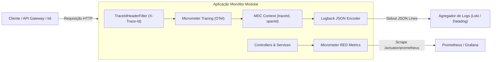

# Especificação de Observabilidade, Métricas RED e SLO

Documento formal de arquitetura de observabilidade, métricas e objetivos de nível de serviço para o **Gerenciador de Vendas de Água Mineral** (Projeto Final Full Cycle - Nível A, em conformidade com o requisito **RNF-M3.3**).

---

## 1. Visão Geral da Arquitetura de Observabilidade

O sistema adota o padrão dos três pilares da observabilidade nativa em nuvem (Logs Estruturados, Métricas RED e Distributed Tracing) totalmente desacoplados e baseados em padrões abertos (**OpenTelemetry**, **Micrometer** e **Prometheus**):



---

## 2. Logs Estruturados em JSON

Todos os logs emitidos pela aplicação em console/stdout seguem rigorosamente o formato JSON estruturado configurado via `logback-spring.xml` com `LoggingEventCompositeJsonEncoder`:

### 2.1. Schema Padrão do Log

Campo | Tipo | Descrição
:--- | :--- | :---
`timestamp` | ISO-8601 | Data/hora precisa do evento com fuso horário (ex: `2026-11-07T20:10:14.415-03:00`).
`level` | String | Severidade (`INFO`, `WARN`, `ERROR`, `DEBUG`).
`service` | String | Nome identificador do microsserviço/aplicação (`gerenciador-vendas-agua`).
`traceId` | String (Hex) | Identificador único distribuído da transação propagado pelo OpenTelemetry.
`spanId` | String (Hex) | Identificador único do segmento/operação dentro do trace.
`thread` | String | Thread do runtime Java responsável pela execução.
`module` | String | Logger class ou pacote abreviado (ex: `c.d.a.orders.application.OrderService`).
`message` | String | Mensagem de negócio ou técnica descritiva do evento.
`stackTrace` | String | Stack trace completo formatado em caso de exceções (opcional).

### 2.2. Exemplo Real de Log Emitido
```json
{
  "timestamp": "2026-11-07T20:10:20.142-03:00",
  "level": "INFO",
  "service": "gerenciador-vendas-agua",
  "traceId": "076540d7bbb8d4fd469319415fe42019",
  "spanId": "3cb0134f71a9b401",
  "thread": "http-nio-8080-exec-1",
  "module": "c.d.a.o.a.OrderService",
  "message": "Created order [ORD-20261107-000001] for customer [Ana Clara] with total [48.00]"
}
```

---

## 3. Distributed Tracing (Micrometer Tracing + OpenTelemetry Bridge)

- **Engine:** `io.micrometer:micrometer-tracing-bridge-otel` e `opentelemetry-api`.
- **Amostragem:** `management.tracing.sampling.probability=1.0` (100% de amostragem em desenvolvimento e staging).
- **Correlação Cliente-Servidor:** O filtro `TraceIdHeaderFilter` injeta automaticamente o cabeçalho HTTP de resposta `X-Trace-Id`. Isso permite que qualquer cliente que receba um erro (ex: 422, 500 ou 404 RFC 7807) ou sucesso forneça o `X-Trace-Id` ao suporte ou time de engenharia para localização instantânea de todos os registros de log correlacionados no aggregador central.

---

## 4. Métricas RED (Rate, Errors, Duration)

As métricas são expostas no formato aberto do Prometheus através do endpoint `/actuator/prometheus`.

### 4.1. Mapeamento RED HTTP (Camada de Transporte)

Dimensão RED | Métrica Prometheus | Descrição e Filtro
:--- | :--- | :---
**Rate** | `http_server_requests_seconds_count` | Taxa total de requisições recebidas por segundo: `sum(rate(http_server_requests_seconds_count[1m])) by (uri)`.
**Errors** | `http_server_requests_seconds_count{status=~"5.."}` | Taxa de respostas HTTP 5xx: `sum(rate(http_server_requests_seconds_count{status=~"5.."}[1m]))`.
**Duration** | `http_server_requests_seconds` | Histograma e percentis calculados (p50, p90, p95, p99): `histogram_quantile(0.95, sum(rate(http_server_requests_seconds_bucket[1m])) by (le))`.

### 4.2. Mapeamento RED de Negócio (Camada de Domínio e Aplicação)

Instrumentadas pelo componente `RedMetricsService`:

Métrica | Tipo | Dimensões / Tags | Descrição
:--- | :--- | :--- | :---
`orders_created_total` | Counter | `status`, `modality` | Total de pedidos criados com segregação por modalidade (entrega vs balcão).
`orders_errors_total` | Counter | `error_type` | Total de falhas na criação de pedidos (ex: `InsufficientStockException`).
`orders_creation_duration_seconds` | Timer | - | Duração e percentis (p50, p95, p99) da transação atômica de criação de pedido.
`payments_processed_total` | Counter | `status`, `method` | Total de liquidações processadas (`PAID`, `FAILED`) por método (`PIX`, `CARD`, etc.).
`payments_processing_duration_seconds` | Timer | - | Duração e percentis da liquidação idempotente com lock no Redis.

---

## 5. Formalização de Service Level Objectives (SLOs) e Indicadores (SLIs)

Para assegurar confiabilidade e resiliência de alto nível (Nível A), a distribuidora opera sob os seguintes acordos objetivos:

### 5.1. Tabela de SLOs Declarados

Objetivo (SLO) | Indicador (SLI) | Fórmula de Cálculo Prometheus | Meta Mensal
:--- | :--- | :--- | :---
**Disponibilidade (Uptime)** | Proporção de requisições HTTP bem-sucedidas (não-5xx) | `(1 - sum(rate(http_server_requests_seconds_count{status=~"5.."}[5m])) / sum(rate(http_server_requests_seconds_count[5m]))) * 100` | **>= 99.5 %**
**Latência Global p95** | 95º percentil do tempo de resposta das rotas HTTP | `histogram_quantile(0.95, sum(rate(http_server_requests_seconds_bucket[5m])) by (le))` | **< 200 ms**
**Latência Global p99** | 99º percentil do tempo de resposta sob picos | `histogram_quantile(0.99, sum(rate(http_server_requests_seconds_bucket[5m])) by (le))` | **< 400 ms**
**Taxa de Erro HTTP 5xx** | Proporção de falhas internas sobre o tráfego total | `sum(rate(http_server_requests_seconds_count{status=~"5.."}[5m])) / sum(rate(http_server_requests_seconds_count[5m])) * 100` | **< 1.0 %**
**Latência de Cache p95** | 95º percentil de consulta ao catálogo (`/api/v1/catalog`) | `histogram_quantile(0.95, sum(rate(http_server_requests_seconds_bucket{uri=~"/api/v1/catalog.*"}[5m])) by (le))` | **< 50 ms**

### 5.2. Regras de Alerta Recomendadas (Alertmanager)

1. **Queima de Error Budget (Crítico):**
   - Condição: Taxa de erro 5xx > 1.0% por mais de 5 minutos contínuos.
   - Severidade: `critical` (PagerDuty / Plantão).
2. **Degradação de Latência (Alerta):**
   - Condição: `p95(http_server_requests) > 200ms` por mais de 10 minutos.
   - Severidade: `warning` (Canal de Engenharia / Slack).
3. **Saturação de Pool de Banco de Dados:**
   - Condição: `hikaricp_connections_pending > 5` por 2 minutos.
   - Severidade: `warning`.

---

## 6. Painéis e Visualização no Grafana (Dashboard RED Provisionado)

O projeto conta com provisionamento declarativo completo do **Prometheus** e **Grafana** via Docker Compose (`docker-compose.yml`), carregando automaticamente o datasource e o dashboard de métricas RED sem qualquer etapa de configuração manual.

### 6.1. Acesso ao Grafana
- **URL Pública Oficial (Nuvem OCI):** [https://129.213.203.42.sslip.io/grafana/d/agua-red-metrics/](https://129.213.203.42.sslip.io/grafana/d/agua-red-metrics/) (Modo Viewer Anônimo habilitado para avaliação sem necessidade de login).
- **URL Local:** [http://localhost:3000](http://localhost:3000)
- **Credenciais de Acesso:** Parametrizadas de forma segura via variáveis de ambiente no arquivo `.env` (`GRAFANA_ADMIN_USER` e `GRAFANA_ADMIN_PASSWORD`), com valores padrão documentados em [.env.example](../.env.example).
- **Nome do Dashboard:** `Gerenciador de Vendas de Água - Observabilidade & Métricas RED` (Pasta: `Observability`, UID: `agua-red-metrics`).

### 6.2. Estrutura dos Painéis do Dashboard

O dashboard está estruturado em 4 seções visuais (*Rows*) projetadas para auditoria em bancas e monitoramento operacional:

1. **🎯 1. SLOs & Visão Executiva (Executive & SLO Overview):**
   - **Uptime da Aplicação:** Tempo total de execução contínua (`process_uptime_seconds`).
   - **Disponibilidade HTTP (SLO $\ge 99.5\%$):** Proporção de requisições sem erros 5xx nos últimos 5 minutos.
   - **Total de Pedidos Criados:** Contador acumulado de pedidos de venda (`orders_created_total`).
   - **Pagamentos Liquidados:** Total de transações com status `PAID` (`payments_processed_total`).
   - **Taxa de Erro 5xx (SLO $< 1.0\%$):** Gauge com cores indicativas (Verde $<0.5\%$, Amarelo $<1.0\%$, Vermelho $\ge 1.0\%$).

2. **🚦 2. Métricas RED de Transporte HTTP (HTTP RED Metrics):**
   - **Taxa de Requisições por Endpoint (Rate / RPS):** Gráfico temporal de requisições por segundo segregadas por URI (`sum(rate(http_server_requests_seconds_count[1m])) by (uri)`).
   - **Taxa de Erros HTTP (Errors):** Distribuição temporal de respostas 4xx e 5xx por código e rota.
   - **Latência HTTP (Duration):** Linhas temporais dos percentis p50 (mediana), p95 (meta SLO $< 200\text{ms}$) e p99 (cauda sob stress) com linha de limiar em 200ms.

3. **💼 3. Métricas RED de Negócio & Domínio (Business RED Metrics):**
   - **Criação de Pedidos por Modalidade:** Gráfico de barras temporais comparando vendas de `BALCAO` vs `ENTREGA`.
   - **Erros de Criação de Pedido:** Falhas de negócio instrumentadas (ex: `InsufficientStockException`).
   - **Pagamentos por Método & Status:** Transações por forma de pagamento (`PIX`, `CARD`, `CASH`, `TRANSFER`) e status (`PAID` vs `FAILED`).
   - **Duração Transacional de Domínio:** Tempo médio (ms) da transação atômica de criação de pedido e da liquidação com lock no Redis.

4. **⚙️ 4. Infraestrutura & Runtime da JVM (JVM & Connection Pool Resources):**
   - **Memória Heap da JVM (Java 21):** Consumo em tempo real de memória heap usada vs limite configurado.
   - **Pool de Conexões HikariCP:** Monitoramento de conexões ativas, conexões ociosas (*idle*) e threads aguardando liberação.
   - **Consumo de CPU:** Uso percentual da CPU pela JVM e pelo sistema operacional hospedeiro.

---

## 7. Verificação e Raspagem de Métricas

Para testar a infraestrutura de observabilidade localmente:

1. **Subida Completa da Stack:**
   ```bash
   docker compose up -d --build
   ```
   Isso inicializa o PostgreSQL, Redis, Spring Boot API, Prometheus e Grafana.
2. **Acesso ao Dashboard:** Abra [http://localhost:3000](http://localhost:3000) e localize o dashboard na pasta `Observability`.
3. **Scrape Prometheus:**
   ```bash
   curl -s http://localhost:8080/actuator/prometheus | grep -E "(http_server_requests|orders_|payments_)"
   ```
4. **Healthcheck:**
   ```bash
   curl -s http://localhost:8080/actuator/health
   ```
5. **Header de Correlação:**
   ```bash
   curl -i http://localhost:8080/api/v1/catalog/products
   # Observe o cabeçalho X-Trace-Id na resposta HTTP
   ```
