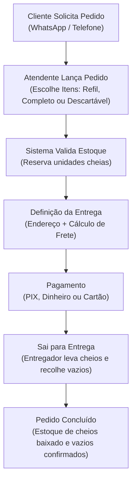
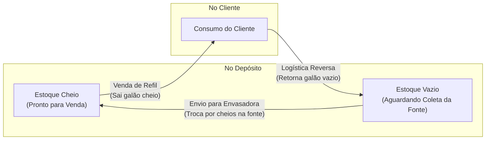
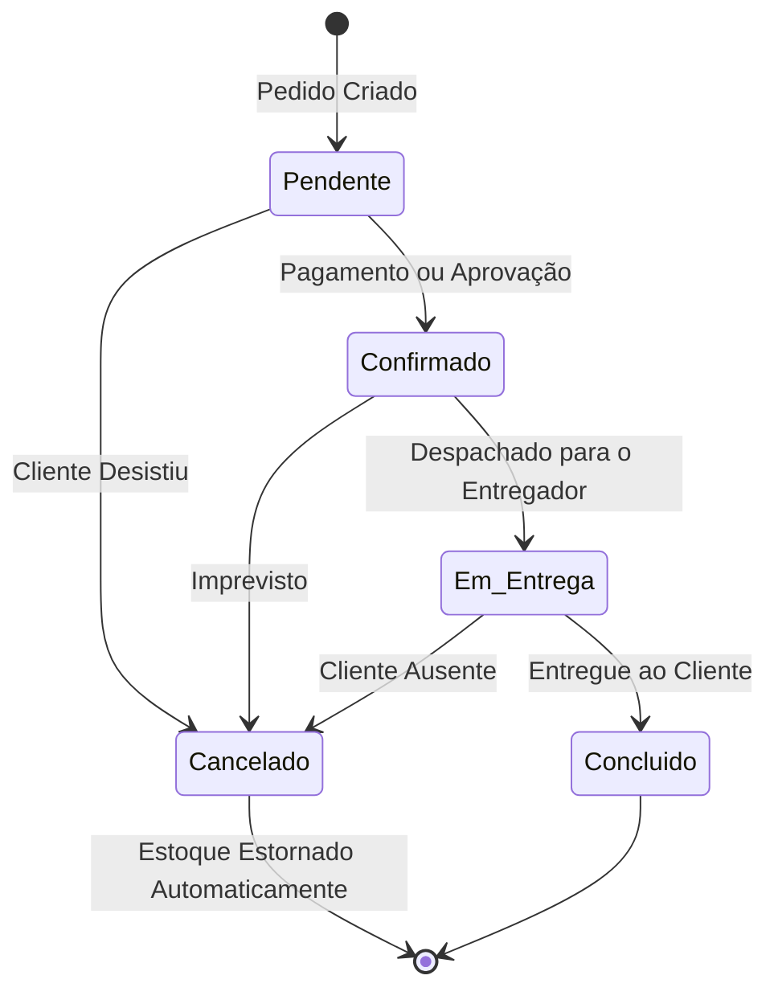

# Documento de Visão e Validação do Produto

**Produto:** Gerenciador de Vendas e Distribuição de Água Mineral  
**Destinatário:** Cliente Final / Gestor da Distribuidora  
**Versão:** 1.0  
**Data:** 07 de Novembro de 2026  
**Status:** Aguardando Validação do Cliente  

---

## 1. Objetivo do Produto

O **Gerenciador de Vendas de Água Mineral** é uma solução desenvolvida sob medida para depósitos e distribuidoras de água. O objetivo principal é **eliminar perdas financeiras e gargalos operacionais**, automatizando o controle rigoroso de vasilhames retornáveis, acelerando o fechamento de pedidos (balcão e entrega) e garantindo segurança absoluta nos recebimentos.

---

## 2. O Que o Sistema Faz (Escopo do Produto)

### 2.1. Controle Inteligente de Vasilhames e Estoque (Estoque Dual)
Na venda de água mineral, o galão não é apenas uma embalagem descartável: ele possui valor comercial e circula constantemente entre o depósito e os clientes. O sistema gerencia esse ciclo de forma automática:

* **Tipos de Operação Suportados:**
  1. **Refil / Troca (o mais comum):** O cliente entrega o galão vazio e leva o cheio. O sistema desconta 1 galão cheio do estoque e soma automaticamente 1 galão vazio no pátio para reenvio à fonte envasadora.
  2. **Água Completa (Garrafão + Água):** Cliente novo que não possui vasilhame para trocar. Desconta 1 galão cheio do estoque.
  3. **Venda de Vasilhame Vazio:** Venda apenas do casco do galão sem água. Desconta do estoque de vazios.
  4. **Produtos Descartáveis:** Fardos, garrafinhas de 500ml e 1,5L. O estoque é baixado normalmente sem movimentar vasilhames vazios.
* **Garantia de Não-Ruptura:** O sistema impede vendas se não houver estoque suficiente, evitando promessas indevidas a clientes.

### 2.2. Gestão de Pedidos (Balcão e Delivery)
* **Venda de Balcão (Retirada Rápida):** Atendimento ágil para clientes que compram diretamente no balcão da distribuidora, com fechamento em poucos segundos.
* **Venda por Entrega (Delivery):** Registro do endereço do cliente, cálculo automático de frete/taxa de entrega (incluindo promoções de frete grátis) e acompanhamento do status do pedido até a entrega final.
* **Cancelamento Seguro:** Caso um pedido seja cancelado, os galões cheios e vazios retornam imediatamente ao estoque sem necessidade de ajustes manuais.

### 2.3. Pagamentos Rápidos e Seguros
* **Meios Aceitos:** PIX, Dinheiro, Cartão de Débito e Cartão de Crédito.
* **Proteção Contra Cobranças Duplicadas:** Tecnologia de segurança que impede que uma mesma cobrança seja registrada em duplicidade caso ocorra clique duplo ou oscilação de internet no momento do pagamento.

### 2.4. Comprovante e Cupom Fiscal
* Emissão de recibo detalhado para o cliente contendo itens comprados, valores, endereço e meio de pagamento.
* Preparado para integração com impressoras térmicas de cupom de balcão.

---

## 3. Fluxos Operacionais do Dia a Dia

### 3.1. Fluxo de Venda por Entrega (Delivery)

### 3.2. Fluxo de Movimentação de Vasilhames (Logística Reversa)

### 3.3. Ciclo de Vida do Pedido (Status)

---

## 4. O Que Está Sendo Entregue (Fases do Projeto)

Para garantir máxima velocidade de entrada em operação e segurança técnica, o projeto está estruturado em **duas fases**:

| Funcionalidade | Fase 1 (Core Atual) | Fase 2 (Expansão) |
| :--- | :---: | :---: |
| **Catálogo de Produtos e Preços** | ✅ Concluído | Evolução |
| **Motor de Estoque Dual (Cheios vs. Vazios)** | ✅ Concluído | Evolução |
| **Abertura e Fechamento de Pedidos (Balcão e Entrega)** | ✅ Em finalização | Evolução |
| **Regras de Frete e Promoção de Frete Grátis** | ✅ Concluído | Evolução |
| **Processamento Seguro de Pagamento (PIX, Cartão, Dinheiro)** | ✅ Em finalização | Evolução |
| **Estorno Automático de Estoque no Cancelamento** | ✅ Em finalização | Evolução |
| **Prévia e Formatação de Cupom Fiscal** | ✅ Concluído | Impressão Física Direta |
| **Telas Visuais de Frente de Caixa (PDV Web/Mobile)** | API Pronta para Conexão | ✅ Construção da Interface |
| **Cadastro Histórico Completo de Clientes e Endereços** | Identificação no Pedido | ✅ Módulo Dedicado |

---

## 5. Roteiro de Validação do Cliente

Por favor, analise os tópicos abaixo e confirme se o comportamento atende perfeitamente à rotina do seu negócio:

### Checklist de Validação:

- [ ] **1. Catálogo e Produtos:** Os tipos de produto atendem à sua operação? (*Galões 20L, 10L, garrafas descartáveis, venda de casco vazio e refil*).
- [ ] **2. Regra de Vasilhames Vazios:** A lógica de devolução de vazios no refil reflete a realidade do seu depósito?
- [ ] **3. Modalidades de Venda:** A distinção entre venda no balcão e pedidos com frete para entrega atende à sua demanda?
- [ ] **4. Formas de Pagamento:** Os métodos (PIX, Dinheiro, Débito, Crédito) cobrem todas as necessidades da sua distribuidora?
- [ ] **5. Cancelamentos:** A regra de devolver automaticamente os galões para o estoque caso o cliente desista ou não esteja no endereço está correta?

---

> [!TIP]
> Caso necessite de qualquer ajuste nas regras de negócio, inclusão de novos produtos ou regras de frete específicas, basta apontar para que possamos incorporar antes da finalização do módulo.
